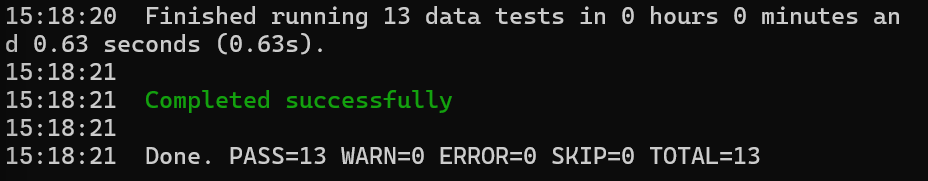

# transactions-dwh

Учебный проект: небольшой потоковый пайплайн для банковских транзакций.
Данные генерируются скриптом, идут через Kafka в ClickHouse, а дальше dbt строит из них витрины.
Сделала, чтобы на практике попробовать Kafka и ClickHouse и собрать то, что до этого изучала на курсах (VK Education, Hadoop/Spark/Kafka).

## Схема

```
producer.py ──► Kafka (топик transactions) ──► consumer.py ──► ClickHouse raw.transactions
                                                                      │
                                                                      ▼
                                                      dbt: stg_transactions (view)
                                                                      │
                                                                      ▼
                                       витрины: daily_turnover, category_daily, top_merchants
```

## Что используется

- Python 3.12, `confluent-kafka`, `clickhouse-connect`
- Apache Kafka (режим KRaft, без ZooKeeper)
- ClickHouse 24.8
- dbt (`dbt-clickhouse`)
- Docker Compose

## Как запустить

Нужен Docker с Compose. Примерно 2-3 ГБ свободной памяти.

```bash
git clone https://github.com/Vitaliya-Gubanova/transactions-dwh.git
cd transactions-dwh
cp .env.example .env        # Windows (cmd): copy .env.example .env

# Kafka, ClickHouse, генератор и загрузчик
docker compose up -d --build

# подождать 30-60 секунд, пока накопятся данные, потом посмотреть логи
docker compose logs -f consumer

# построить витрины и прогнать тесты
docker compose --profile dbt run --rm dbt
```

Остановить: `docker compose down` (с `-v`, если хочется удалить и данные ClickHouse).

## Проверка, что всё работает

Зайти в ClickHouse можно так:

```bash
docker compose exec clickhouse clickhouse-client --user dwh --password dwh
```

Несколько запросов:

```sql
-- сколько строк пришло
SELECT count() FROM raw.transactions;

-- сколько записей отфильтровал слой stg (брак с отрицательной суммой)
SELECT
    (SELECT count() FROM raw.transactions) AS raw_rows,
    (SELECT count() FROM analytics.stg_transactions) AS clean_rows;

-- витрины
SELECT * FROM analytics.daily_turnover;
SELECT * FROM analytics.top_merchants;
```

## Как устроено

**producer** (`producer/producer.py`) раз в долю секунды создаёт транзакцию (клиент, мерчант, категория, сумма) и отправляет JSON в Kafka. Около 1% записей генерируются с отрицательной суммой — это "брак", нужен, чтобы было что чистить на следующих шагах. Скорость задаётся переменной `EVENTS_PER_SECOND`.

**consumer** (`consumer/consumer.py`) читает топик, собирает сообщения в пачки (по 200 штук или раз в 5 секунд) и вставляет их в ClickHouse. Оффсеты коммитятся только после успешной вставки, поэтому при падении между вставкой и коммитом возможны дубли, но потерь нет (at-least-once). Битые сообщения пропускаются и считаются в логе.

**ClickHouse**: таблица `raw.transactions` на движке MergeTree, партиции по месяцам, сортировка по `(event_time, transaction_id)`. Схема создаётся скриптом `clickhouse/init.sql` при первом старте.

**dbt** (`dbt_project/`):
- `stg_transactions` — убирает записи с суммой <= 0 и дубли по `transaction_id` (через `LIMIT 1 BY`, это особенность ClickHouse)
- `daily_turnover`, `category_daily`, `top_merchants` — витрины в виде таблиц
- тесты: `not_null`, `unique`, `accepted_values` для категорий и отдельный SQL-тест на положительную сумму (всего 13)

## Тесты

Юнит-тесты на генератор и разбор сообщений (Kafka и ClickHouse для них не нужны):

```bash
pip install -r requirements-dev.txt
python -m pytest tests
```

## Результат тестового прогона

Запускала стек локально при 5 событиях в секунду. За несколько минут в `raw.transactions` накопилось около 2 тысяч строк. `dbt run` собрал все 4 модели, `dbt test` прошёл 13 тестов из 13.



## Ограничения и что можно улучшить

- Один брокер Kafka и один узел ClickHouse, без репликации — проект учебный.
- Гарантия доставки at-least-once. Дубли убираются в dbt, но можно перейти на ReplacingMergeTree или сделать идемпотентную вставку.
- Витрины пересчитываются целиком (`table`), а не инкрементально. Для маленького объёма данных это нормально, для большого нужны инкрементальные модели.
- Обработка в consumer простая (без Spark / Flink). Следующий шаг — Spark Structured Streaming с оконными агрегатами.
- Запуск dbt вручную. Хочу добавить Airflow, как в моём проекте [weather-etl-pipeline](https://github.com/Vitaliya-Gubanova/weather-etl-pipeline), и дашборд в Superset.
- Нет CI.
